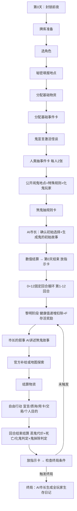

# 《黎明之后》机制子稿：回合流程系统

> **使用说明**：本文档是"回合流程系统"的唯一真实来源。回合流程相关的机制更新、迭代记录、设计意图均在本文档内进行增删改查。生成新版设计稿时，以本文档内容为准。
>
> **拆分来源**：V1.5第三章（3.1-3.5）+ 第七章7.3（鬼叙事演变）+ 第六章6.1/6.2/6.7
>
> **最后更新**：2026-07-05（V1.9.2：叙事重构——步骤1从"鬼的叙事"替换为"市长的叙事"；市长每回合讲述煞鬼的故事；终局生成全玩家生存日记）

---

## 一、机制详解

### 1.1 阶段零：封锁前夜（第0天）

#### 牌库准备（第0天第一个动作之前）

1. **官方物资**：准备官方物资（保障餐A）牌库，共18张。
2. **物资牌库**：将普通物资（34张）、中级物资（18张）、高级物资（8张）、绝顶物资（3张）充分洗切，成为物资牌库【物资库】。
3. **反击卡**：从反击卡中挑选出12张不同种类的**基础等级事件卡**（即全部12种基础卡各1张），剩余的事件卡充分洗切成为事件卡的牌库【反击卡】。
4. **规则卡**：把规则卡充分洗切，成为规则牌库【规则怪谈】。
5. **怪谈卡**：把全部36张怪谈卡置于共享池，全部处于未激活状态。所有鬼共享此牌池。
6. **基础伤害指示卡**：把若干数量的基础伤害指示卡置于桌上，供所有玩家随时取用或分发一些给所有玩家。
7. **基础回合指示卡**：把所有基础回合指示卡分发——每同一回合的指示卡每个玩家四张（两组）（两张纵向两张横向）。在第0天分发所有指示卡。
8. **硬币**：准备硬币（正面人类剪影，背面鬼剪影）放于地图旁。

> 基础回合指示卡的详细功能和分发数量详见 [堆叠式角色面板](黎明之后_机制_堆叠式角色面板.md)。

#### 第0天执行流程

**步骤1：选取/抽取角色**

每位玩家从角色卡牌库中随机抽取1张，获得现实身份与被动技能。角色卡面朝上放置在自己面前。

> 注：原步骤1"选择祝福/遗物"已删除（祝福遗物卡系统已确认搁置）。

**步骤2：秘密填报地点**

所有玩家秘密填报两个地点（可以写编号可以写名称，写名称必须是跟地图一模一样的字）。由市长左侧/右侧第一个玩家开始依次交给市长，并需要说明理由（即为什么去了这两个地方，如理由不合理市长可予以否定，并重新选地点）。

- **6-8人**：建议开放其中一区选地点，避免多次无法选中鬼。
- **9-12人**：可以开放两区。这个按玩家自己商讨。

> 地图机制的详细规则详见 [地图系统](黎明之后_机制_地图系统.md)。

**步骤3：分配初始物资**

每位玩家分配1张官方物资（保障餐A）。剩余的官方物资构成官方物资牌库，供后续回合玩家选择"官方补给"时抽取。

> 官方物资（保障餐A）效果：健康+1 / 理智+1。官方物资牌库共18张，用完即止。详见 [物资卡系统](黎明之后_机制_物资卡系统.md) 1.3节。

**步骤4：事件卡初始分配**

**4a. 基础事件卡选取**：每人从反击卡中**选取**一张基础等级事件卡（可查看所有基础卡后选择），放入自己的【未激活区】。

**4b. 牌库洗切**：剩余的事件卡（含基础、觉醒、极致、真理）充分洗切，成为正式的【反击卡】牌库。

**4c. 抽取两轮**：所有玩家按顺序从【反击卡】顶部**抽取一张**，共进行两轮。即每人开局获得**3张事件卡**（1张基础自选+2张随机）。

> **倒霉体质者**：在此阶段额外从【反击卡】抽取1张（共4张）。详见角色卡图鉴。

> 事件卡获取的完整规则（含不屈/智慧/奖赏/存活等途径）详见 [反击卡图鉴](黎明之后_反击卡图鉴.md) 第三章。

**步骤5：鬼宣言激活怪谈**

鬼浏览自己的事件卡牌库【怪谈】，把其中已经激活的卡片挑选出来，并公开宣言卡名和激活原因。

**步骤6：人类抽事件卡**

鬼宣言完激活的【怪谈】之后，人类阵营按顺序从【反击卡】顶部抽卡，每人两张。

> 倒霉体质者在此阶段有额外事件卡获取，详见角色卡图鉴。

**步骤7：第1天黎明地图设置**

> 此步骤已在V1.8.2移至第1天黎明阶段执行，不在第0天进行。第0天物资分配已在步骤3完成（每人1张官方物资）。
> 
> 第1天黎明的地图设置（物资/事件/鬼的随机判定）详见 [地图系统](黎明之后_机制_地图系统.md) 第三节。

**步骤8：公开闹鬼的地点**

公开闹鬼的地点，公开特殊规则（从规则牌库中检索出该地点相关的特殊规则卡，作为公开规则置于公开规则栏的"影响全体"分区），公开化鬼的玩家。

> 公开规则栏的详细规则详见 [宣言质询系统](黎明之后_机制_宣言质询系统.md)。
> 特殊规则卡从公开那一刻开始即影响游戏（第0天即生效）。隐藏规则则从第一天开始才生效。

**步骤9：鬼抽取规则卡**

化鬼的玩家抽取属于他的规则卡X张（X=人类玩家的数目）。这些规则卡为鬼的隐藏规则，可以被人类宣言抹除。

> 注：原"本局规则数=人数×6"公式已废弃。鬼抽取的规则卡数量=X张（X=人类玩家数目）。

**步骤10：数值结算**

进行第0天的所有玩家的数值结算。包括那些公开的特殊规则的效果（从公开那一刻开始生效）。

**步骤11：第0天结束**

- 第0天不可以使用物资卡。
- 第0天不可以使用事件卡。
- 第0天不可以宣言规则。
- **放置基础回合指示卡**：第0天结算完毕后，每位玩家在四个方向各放置基础回合指示卡作为日期分隔线（2纵向+2横向）。

> 第0天不执行黎明扣除。所有玩家第0天以满值进入，第1天开始前（黎明）才执行递增扣除。

---

### 1.2 阶段一：人类回合循环（0+12固定回合制）

游戏进入回合循环。固定执行12个游戏回合（编号1-12）。

#### 存活玩家轮转规则

每回合按存活玩家的座位顺序轮流执行回合，规则如下：

- **存活玩家**（未死亡、未化鬼）：按座位顺序执行各自回合。
- **死亡/化鬼的玩家**：从轮转中跳过，不参与后续回合。
- **只剩1名存活人类**：该玩家连续执行剩余全部回合（不受轮转限制）。
- **游戏回合编号**：回合编号从1到12固定递增，每执行完一个存活玩家的回合，编号+1。

> **示例**：6人局，假设4号玩家化鬼。
> - 第1回合：1号 → 第2回合：2号 → 第3回合：3号 → 第4回合：5号 → 第5回合：6号 → 第6回合：1号……
> - 若3号和6号均化鬼，则：第7回合：2号 → 第8回合：5号 → 第9回合：1号 → 第10回合：2号 → 第11回合：5号 → 第12回合：2号
> - 若只剩1号存活：第10/11/12回合全部由1号执行。

> **注**：鬼不参与人类回合轮转。鬼的行动通过鬼的事件卡系统（怪谈）和鬼叙事环节执行。

#### 每个玩家回合的标准流程

##### 步骤0：黎明阶段（回合正式开始前）

每个回合（天）正式开始前，执行黎明阶段：

- **健康值递增扣除**：所有人类玩家健康值按递增规则扣除。第1天-1，第2天-2，第3天起-3（封顶-3）。此扣除不受任何技能或卡牌影响。
- 扣除后健康值可能降至0以下，但玩家不会立刻死亡——他们有整个回合的时间通过物资卡恢复。结算时健康值若仍≤0，才判定死亡。
- 以**基础伤害指示卡**形式从角色卡背面插入对应方向，露出数值栏，记录本次黎明扣除。

> **存活奖励（F）**：每个玩家成功存活到3/6/9/12回合时，在该回合的黎明阶段从【反击卡】抽取一张事件卡。

> 健康值递增扣除的详细规则详见 [双维属性系统](黎明之后_机制_双维属性系统.md) 1.3节"递增黎明扣除机制"

##### 步骤1：市长的叙事（本回合开始时）

> **V1.9.2更新**：此步骤从"鬼的叙事"替换为"市长的叙事"。鬼不再自己讲故事，叙事职能完全移交AI市长。

每个回合开始时，**市长（AI）**讲述一段煞鬼的过往故事（约30-60秒）。

- 故事由市长在开局时根据煞鬼的初始隐藏规则预先生成——每条规则对应一段故事。市长每回合按顺序讲述其中一段。
- 若煞鬼后续更改规则导致规则数增加，市长追加生成对应的新故事段。

人类的作用：
- 可自由讨论故事内容，试图推理规则。
- 可打断一次，质疑故事细节并尝试推理其隐含的规则。市长判定：
  - **合理**（推理与某条规则存在逻辑关联且表述清晰）：推理内容被记录，若正确则视为一次成功的宣言抹除。
  - **不合理**（推理与所有规则均无关联或表述含糊）：质疑者理智值-1。

> 市长的叙事相关完整规则详见 [AI市长系统](黎明之后_机制_AI市长系统.md) 步骤4a。

##### 步骤2：物资阶段——官方补给或地图探索

回合玩家必须公开宣言选择以下其中一项：

- **选择A：官方补给**
  - 若官方物资牌库非空：市长从官方物资牌库中抽取3张**保障餐A**，发给回合玩家。
  - 若官方物资牌库已空：回合玩家不能选择官方补给，本步骤跳过（视为选择地图探索，若健康值允许）。
  
- **选择B：地图探索**
  - 回合玩家执行地图探索流程（详见 [地图系统](黎明之后_机制_地图系统.md) 第四节）。
  - 给自己放置一枚**健康-1指示物**（探索耗费体力）。
  - 若回合玩家健康值≤0（濒死），不能选择地图探索，只能选择官方补给（若官方物资牌库非空）。

> 官方物资（保障餐A）：健康+1 / 理智+1，卡面统一标识。官方物资牌库共18张，用完即止。
> 地图探索可能获得普通/中级/高级/绝顶物资，也可能抽中事件卡或撞鬼。详见地图系统子稿。

##### 步骤3：结算物资

回合玩家将物资卡从角色卡背面插入对应方向，属性即时生效。

> 交易的具体规则详见 [交易系统](黎明之后_机制_交易系统.md)。交易为自愿行为，可在任意时机进行，规则不予以限制。

##### 步骤4：自由行动

回合玩家可进行以下行动（先后顺序由玩家自行决定）：

- **宣言抹除规则**：若回合玩家已推理出某条规则内容，可正式宣言。由市长判定猜对/猜错。
  - **猜对**：鬼拿出该规则卡，朗读完整文本，置于公开规则栏的"被抹除规则"分区。
  - **智慧奖励（D）**：每个玩家宣言并成功抹除鬼的规则达到2/4/6次时，各能抽取一次事件卡。
- **即时质询鬼**：若回合玩家怀疑鬼在某时刻违反了规则，可即时质询。市长判定成立/不成立。
  - **成立**：鬼受到对应惩罚。
  - **奖赏（E）**：质询成功可抽一张事件卡或物资卡（二选一）。
- **使用已激活事件卡**：若回合玩家手中有已激活的"反击卡"事件卡，可在此时机打出。
- **完成个人目的**：若回合玩家满足了个人目的卡的条件，可秘密告知市长，确认完成后获得奖励。
- **自愿交易**：玩家可在此阶段自发进行物资卡的交易、赠予、协商。

> 宣言/质询的具体规则详见 [宣言质询系统](黎明之后_机制_宣言质询系统.md)。

##### 步骤5：回合结束结算

- 市长（AI）结算所有属性变化：
  - **恶鬼代价（每回合必须执行）**：检查每只恶鬼（详见 [鬼身份卡系统](黎明之后_机制_鬼身份卡系统.md)）在本回合是否使用过自己的规则侵蚀过人类。
    - **已侵蚀**：本回合无额外惩罚。
    - **未侵蚀**：在结算阶段给该恶鬼放置一枚**理智-2指示卡**（以基础伤害指示卡形式插入角色卡对应方向）。
  - **健康值死亡判定**：检查所有人类玩家的健康值。健康值≤0的玩家**死亡**，退出游戏。
  - **理智值结算**：若有玩家因本回合行为应被扣理智值，在此统一结算。同样以**基础伤害指示卡**形式插入角色卡对应方向。（增设"抢救窗口"——理智值在回合结束统一结算，结算前若通过交易/事件卡恢复理智值，可免于变鬼。）
  - **理智值化鬼判定**：理智值≤0的玩家被同化为鬼。
  - **鬼的理智归零判定**：若某只鬼（煞鬼或恶鬼）的理智值≤0，该鬼被**抹除**，从游戏中移除。其持有的未抹除规则按规则卡图鉴处理（详见鬼身份卡系统）。
  - **鬼用规则抹除其他鬼的继承**：若某只鬼因另一只鬼的规则而被抹除，该鬼被抹除时持有的所有未抹除规则转移给发动规则的那只鬼。
- **不屈奖励（C）**：若本回合有人类阵营玩家死亡或被同化为鬼，剩余所有玩家各从【反击卡】抽取一张事件卡。
- **放置基础回合指示卡**：本回合所有数值结算完毕后，每位玩家在四个方向各放置基础回合指示卡作为日期分隔线（2纵向+2横向）。
  > 详见：[堆叠式角色面板](黎明之后_机制_堆叠式角色面板.md) "基础回合指示卡"章节
- **检查终局条件**：见第1.4节。

---

### 1.3 阶段二：鬼的事件卡发动时机

鬼的事件卡不占用独立回合，而是在以下时机可随时打出（需满足卡的发动条件）：

- 任意玩家回合的"自由行动"阶段，鬼可打断并打出事件卡。
- 任意玩家回合结束后，终局结算前，鬼可打出事件卡。
- 满足特定事件卡的"即时发动"条件时（如"当有玩家成功宣言抹除规则时"），鬼可立刻打出对应事件卡。

---

### 1.4 终局条件与胜利判定

#### 终局触发条件（满足任一即结束游戏）

| 条件 | 结果 | 触发时机 |
|:---|:---|:---|
| 所有人类被同化为鬼或死亡 | **鬼胜利** | 在某回合结束时判定 |
| 所有鬼被抹除（理智归零或更低） | **人类胜利** | 在某回合结束时判定，游戏截至该回合 |
| 固定12回合全部执行完毕，仍有存活的鬼 | **共同胜利** | 第12回合结算完毕后 |

#### 胜利判定

- **鬼胜利**：所有人类被同化或死亡。
- **人类胜利**：所有鬼在第12回合结束前被抹除。
- **共同胜利**：第12回合结算完毕时，仍有存活的鬼存在。此时**所有存活个体**（包括存活的鬼和存活的玩家）共同胜利，其他所有已死亡或被抹除的玩家落败。每个存活个体按完成个人目的数量获得个人评分。

> **V1.9.2更新**：终局不再生成单一叙事（如"鬼的日记""反击卡·终章"）。改为由AI市长根据全程记录，为每一位玩家（无论胜负、无论生死）生成个人**生存日记**（叙事+复盘合一）。详见 [AI市长系统](黎明之后_机制_AI市长系统.md) 步骤6。

#### 共同胜利的意义

共同胜利是"活下来才是赢家"的终极表达。游戏设计者认为：在末世中，能活到最后的人——无论他是人类还是曾经化鬼的人——都是这场游戏的胜者。这给了玩家在绝境中"向鬼阵营投降以换取存活"的策略空间，也增加了游戏的道德张力。

---

### 1.5 游戏流程图

> **V1.9.2更新**：流程图中"鬼叙事"替换为"市长的叙事"；新增步骤A10（AI市长确认初始选择并生成鬼的初始故事）和步骤C（终局生成全玩家生存日记）。

---

## 二、设计意图

### 2.1 鬼的叙事环节——从核心机制到"氛围组"再到"市长叙事"的三次演变

鬼的叙事环节经历了三次重要的定位调整。在V1.0时期，它是整个游戏的核心引擎——鬼每回合讲述隐含规则的故事。随着事件卡系统的完善，叙事环节的核心地位被逐步替代，V1.5时期被重新定义为"推理辅助线索+氛围营造"。

**V1.9.2第三次演变**：叙事职能完全移交AI市长。鬼不再需要即兴叙事能力。市长根据煞鬼持有的规则数量和内容，分段生成过往故事并在每回合开始时讲述。这次重构解决了三个核心问题：鬼玩家的即兴负担、叙事质量的不稳定性、以及终局叙事仅覆盖鬼视角的局限。当前版本中，市长的叙事承担两个功能：为人类提供推理线索的辅助来源，和为整局游戏奠定持续的不安氛围。

### 2.2 回合框架的设计哲学

回合框架的迭代体现了"填充空旷感"的设计哲学。一个好的桌游回合，应该让"回合玩家"有事情做，同时让"非回合玩家"也有事情关心。

### 2.3 双引擎填充回合，杜绝挂机和冷场

桌游最大的敌人是"挂机感"——轮到别人时，我没事情可做。《黎明之后》通过双引擎解决这个问题：

- **生存需求引擎**：每个回合黎明时递增扣除健康值（第1天-1、第2天-2、第3天起-3），必须摸牌、交易、维持生存，没有人能脱离经济体系。
- **社交互动引擎**：自愿交易、协商、结盟、背叛——玩家的社交互动不受规则强制，而是自发涌现。

> 注：原"三重引擎"中的"强制社交交易引擎"已随强制交易机制一并删除。个人目的作为叠加在双引擎之上的个人动力层存在，详见个人目的卡系统子稿。

### 2.4 第0天流程详细化的设计意图

V1.7将第0天从笼统的"封锁前夜"细化为11个具体步骤，核心目的有三：

1. **确立牌库准备的标准流程**——每种牌库的来源和准备方式明确化，避免开局混乱。
2. **地图机制集成**——第0天是地图机制（选鬼、物资、闹鬼伴随）唯一生效的时机，所有地图相关判定集中在第0天完成。
3. **事件卡分配流程清晰化**——先公开分配基础事件卡，再由鬼宣言激活怪谈，然后人类从反击卡补充抽卡，形成有层次的初始手牌构成。

---

## 三、迭代记录

### 3.1 核心机制"黎明之后"迭代记录

| 版本 | 内容 | 设计理由 | 删除/保留 |
|------|------|----------|------------|
| V1.0 | 鬼每回合讲一个故事，必须隐含自己的规则。 | 初始构想。 | **V1.9.2已替换为市长叙事** |
| V1.1 | 增加AI市长判定"故事与规则的关联性"。 | 解决玩家不善言辞+真人市长无法客观裁定两个痛点。 | 保留（移至市长系统） |
| V1.2 | 曾设计"人类也可讲故事"的双向叙事对抗机制。 | 为解决"人类回合空旷感"。 | **已删除** |
| V1.3 | 移除"人类对等讲故事"机制。增加鬼的身份卡系统和AI终局叙事功能。 | 人类讲黎明之后让游戏重心偏移；事件卡系统已足够丰满。 | 身份卡已删除（V1.9.2），终局已更替 |
| V1.5 | 规则卡模型重置为128张总库。 | DS1.4错误使用了24张固定模型，与图鉴矛盾。 | 保留 |
| V1.5 | 六区域系统联动：物资卡插入方向、回合结束结算新增放置回合指示卡步骤。 | 配合堆叠式角色面板六区域系统重构。 | 保留 |
| V1.6 | 健康值扣除时机重构：新增步骤0黎明阶段（递增扣除），步骤6结算改为仅做死亡/化鬼判定。 | 前置压力感受，递增设计让早期有喘息空间。 | 保留 |
| V1.7 | 第0天流程详细化（11步）；删除步骤3强制交易，步骤顺延；新增地图/公开规则栏联动；事件卡分配流程改为"基础卡公开分配+怪谈宣言后每人从反击卡抽2张"；鬼抽规则卡改为X张（X=人类数）；第0天也放基础回合指示卡。 | 大更新：集成地图系统、公开规则栏、基础卡类别等新机制。 | 当前版本 |
| V1.9.2 | **叙事重构**：步骤1从"鬼的叙事"替换为"市长的叙事"——市长每回合讲述煞鬼的过往故事；第0天新增步骤A10（市长确认初始选择并生成鬼的初始故事）；终局叙事从"鬼的日记/反击卡·终章/共同胜利叙事"重构为"全玩家生存日记"（叙事复盘合一）；流程图更新 | 解决鬼即兴负担、叙事质量不稳定、终局单一视角三大问题；规则→故事段映射让叙事有机制支撑。 | 当前版本 |

### 3.2 回合行动框架迭代记录

| 版本 | 内容 | 设计理由 | 删除/保留 |
|------|------|----------|------------|
| V1.0 | 玩家回合内可自由交易、讨论、推理。 | 初始构想。 | 保留核心框架 |
| V1.1 | 引入"回合玩家摸取物资并强制分配"的引擎。 | 解决"回合太空"。 | 已删除（V1.7） |
| V1.2 | 形成"摸牌-事件驱动-强制交易"的完整回合结构。 | 强化回合玩家的"主人翁"感。 | 已删除（V1.7） |
| V1.3 | 删除独立的"鬼的回合"，简化流程。 | 独立鬼回合会让人类集体挂机。 | 保留 |
| V1.7 | 删除强制交易，改为自愿交易。步骤顺延（原步骤3删除，原步骤4→步骤3，原步骤5→步骤4，原步骤6→步骤5）。 | 强制交易是被动的机械交换，改为自愿交易让每次交易成为主动策略决策。 | 当前版本 |

### 3.3 鬼的回合迭代记录

| 版本 | 内容 | 设计理由 | 删除/保留 |
|------|------|----------|------------|
| V1.0 | 曾设计独立的鬼回合。 | 为给鬼提供主动压迫的主场。 | **已删除** |
| V1.1 | 曾设计鬼回合中物资分配权转移等机制。 | 深化鬼回合策略性。 | **已删除** |
| V1.2 | 最终删除独立的鬼回合。鬼的压迫功能由事件卡系统承担。 | 独立鬼回合会让5/6的玩家挂机。 | 删除冗余设计 |

### 3.4 终局条件迭代记录

| 版本 | 内容 | 设计理由 | 删除/保留 |
|:---|:---|:---|:---|
| V1.7 | 三条件：人全灭=鬼赢/规则全抹=人赢/固定5回合=个人成功 | 初步建立终局体系。 | 已更替（V1.9.1） |
| V1.9.1 | 三条件：人全灭=鬼赢/鬼全抹=人赢/12回合后共活=共胜 | 增加共同胜利结局；固定12回合制让游戏时长可控。 | 当前版本 |

### 3.5 回合结构迭代记录

| 版本 | 内容 | 设计理由 | 删除/保留 |
|:---|:---|:---|:---|
| V1.7 | 每人轮一遍算一圈，回合数=存活人数 | 自然结束但时长不可控。 | 已更替（V1.9.1） |
| V1.9.1 | 固定12回合，存活玩家轮转，死亡/化鬼者跳过，只剩1人则连续执行 | 时长固定可控，共同胜利叙事意图更清晰。 | 当前版本 |

---

## 四、更新日志

| 日期 | 更新内容 |
|------|----------|
| 2026-06-23 | 从V1.5拆分，初始创建 |
| 2026-06-23 | 六区域系统联动：物资卡插入方向更新、回合结束结算新增"放置回合指示卡"步骤 |
| 2026-06-23 | 健康值扣除时机重构：新增步骤0黎明阶段，步骤6结算改为仅做死亡/化鬼判定 |
| 2026-06-24 | V1.7大更新：第0天流程详细化（11步）；删除强制交易（步骤顺延）；删除祝福/遗物步骤；新增地图/公开规则栏联动；事件卡分配流程改写；鬼抽规则卡改为X张；第0天也放指示卡；引擎体系从三重改为双引擎 |
| 2026-06-30 | **V1.8.2大更新**：牌库准备新增官方物资牌库（18张）+物资牌库（63张）+硬币；第0天步骤3改为分配官方物资（保障餐A）每人1张；第0天步骤7移除（改为第1天黎明地图设置）；人类回合流程步骤2改为"官方补给或地图探索"二选一 |
| 2026-07-02 | **V1.9.1大更新**：回合结构改为0+12固定回合制（存活玩家轮转，死亡/化鬼者跳过）；终局条件重写（鬼灭=人胜/全灭=鬼胜/12回合后共活=共胜）；回合结束结算新增恶鬼代价机制（不用规则侵蚀人类则-2理智）；鬼可互扣理智并继承规则 |
| 2026-07-05 | **V1.9.2叙事重构**：步骤1从"鬼的叙事"替换为"市长的叙事"；第0天新增AI市长确认初始选择+生成鬼初始故事；终局叙事重构为全玩家生存日记；流程图更新（文本→mermaid）；设计意图2.1节更新为三次演变 |

---

**小灯提醒**：本子稿是"回合流程系统"的权威来源。回合流程相关的任何更新都在本文件内进行。生成新版设计稿时，以本文件内容为准。
