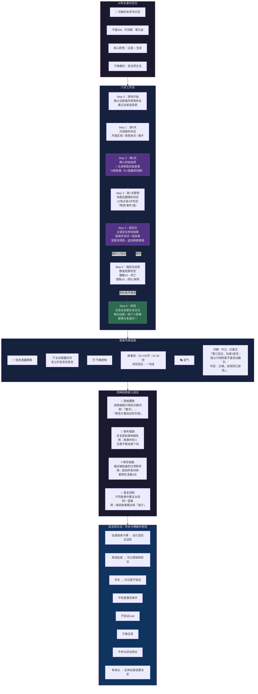

# 《黎明之后》流程图 — 分图8：AI市长6步工作流

> **版本**：V1.0（2026-07-05）
> **关联图**：总览 / 分图1（回合流程） / 分图4（宣言质询） / 分图7（鬼体系）
> **格式**：Mermaid

---

## 分图8：AI市长6步工作流

---

## AI市长六步工作流速查

| 步序 | 时机 | 核心工作 | 输出 |
|:---:|------|------|------|
| 0 | 游戏开始 | 确认玩家编号+角色名 | 玩家追踪表 |
| 1 | 第0天 | 开局随机判定（区域/闹鬼地点） | 判定结果记录 |
| 2 | 第0天 | 确认初始选择 + 生成煞鬼故事 | N段故事（N=隐藏规则数） |
| 3 | 第1天黎明 | 12地点地图设置（物资/事件/鬼） | 完整地图状态 |
| 4 | 每回合 | 记录宣言+讲述故事+规则变更确认 | 该回合记录+故事段 |
| 5 | 每回合结束 | 数值结算判定 | 生死/同化/抹除判定 |
| 6 | 终局 | 生成全玩家生存日记 | 每位玩家个人叙事 |

---

## 四种技法应用示例

| 技法 | 故事线索 | 推理方向 |
|------|------|------|
| 隐喻置换 | "计量命运的东西" | → 隐藏规则与"数字"有关 |
| 缺失强调 | "所有人都不敢提那个字" | → 隐藏规则禁止说出某个词 |
| 秩序扭曲 | "钟全部停在3点" | → 隐藏规则与"时间"或"3"有关 |
| 重复回响 | 每段故事中出现"镜子" | → 隐藏规则与"镜像"或"反射"有关 |
