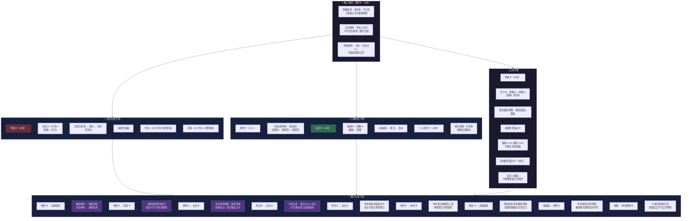

# 《黎明之后》流程图 — 分图9：卡牌体系总览关系网络

> **版本**：V1.0（2026-07-05）
> **关联图**：总览 / 分图1-8 / 本图为全局卡牌互动关系汇总
> **格式**：Mermaid

---

## 分图9：卡牌体系总览关系网络

---

## 全部卡牌数量总览

| 类别 | 归属 | 数量 | 核心机制 | 竣工 |
|------|:---:|:---:|------|:---:|
| 规则卡 | 鬼持有 | 52张 | 隐藏/公开/特殊规则 | 🎉 |
| 角色卡 | 人/鬼 | 12张 | 5类型+被动/觉醒技 | 🎉 |
| 反击卡 | 人类 | 62张 | 四等级+6条获取 | 🎉 |
| 怪谈卡 | 鬼 | 36张 | 四等级+全局共享池 | 🎉 |
| 个人目的卡 | 人类 | 24张 | 秘密驱动力，无奖惩 | 🎉 |
| 物资卡 | 共用 | 81张 | 五等级+恢复属性 | ✅ |
| 基础指示卡 | 共用 | 若干 | 可视化伤害追踪 | ✅ |
| 回合指示卡 | 共用 | 96张 | 四维度每日分隔符 | ✅ |
| **合计** | — | **267+** | — | — |

---

## 卡牌互动关系矩阵

| → 影响 ↓ | 规则卡 | 反击卡 | 怪谈卡 | 角色卡 | 物资卡 | 个人目的 |
|:---:|:---:|:---:|:---:|:---:|:---:|:---:|
| **规则卡** | — | 被宣言抹除 | 提供激活条件 | 约束行为 | 间接影响 | 间接约束 |
| **反击卡** | 抹除规则 | — | 对抗抵消 | 强化能力 | — | — |
| **怪谈卡** | 修改规则 | 对抗抵消 | — | 削弱/打击 | — | — |
| **角色卡** | 被约束 | 获取/强化 | 被影响 | — | 消耗/使用 | 驱动行为 |
| **物资卡** | — | — | — | 恢复属性 | — | — |
| **个人目的** | 被约束 | — | — | 驱动行动 | — | — |
