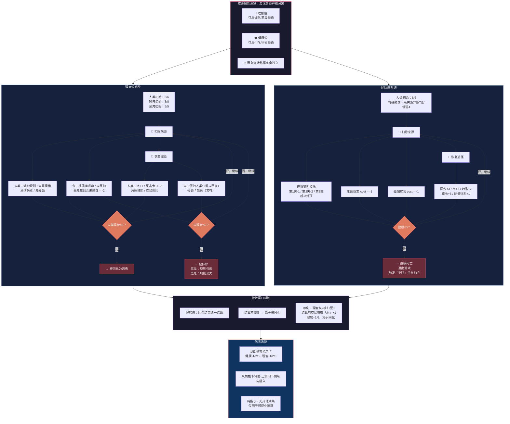

# 《黎明之后》流程图 — 分图5：双维属性+生死判定

> **版本**：V1.0（2026-07-05）
> **关联图**：总览 / 分图1（回合流程） / 分图4（宣言质询） / 分图7（鬼体系）
> **格式**：Mermaid

---

## 分图5：双维属性 + 生死判定

---

## 属性数值速查

### 理智值

| 维度 | 人类 | 煞鬼 | 恶鬼 |
|------|:---:|:---:|:---:|
| 初始 | 6/6 | 8/8 | 5/5 |
| 归零后果 | 被同化为恶鬼 | 被抹除 | 被抹除 |
| 主要扣除 | 触犯规则/质询失败 | 被质询/鬼互扣 | 被质询/代价-2 |
| 恢复途径 | 水/反击卡/技能/交易 | 侵蚀人类/怪谈 | 侵蚀人类/怪谈 |

### 健康值

| 维度 | 数值 |
|------|------|
| 初始 | 6/6（特殊角色有修正） |
| 归零后果 | 直接死亡 |
| 黎明扣除 | -1 → -2 → -3封顶 |
| 恢复 | 面包+3 / 水+2 / 药品+2 / 罐头+5 |
