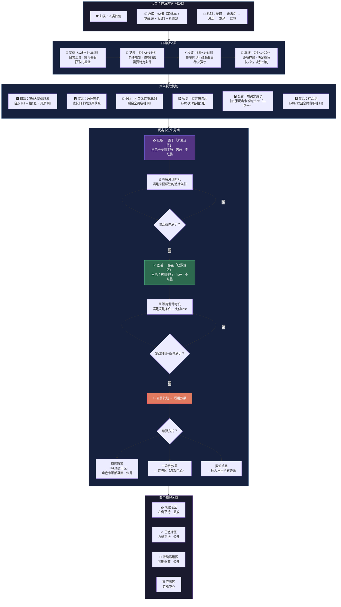

# 《黎明之后》流程图 — 分图3：反击卡体系

> **版本**：V1.0（2026-07-05）
> **关联图**：总览 / 分图1（回合流程） / 分图9（卡牌总览）
> **格式**：Mermaid

---

## 分图3：反击卡体系（四等级 + 6条获取 + 激活/发动）

---

## 六条获取速查

| 编号 | 名称 | 触发时机 | 数量 |
|:---:|------|------|:---:|
| A | 初始 | 第0天开局 | 3张/人 |
| B | 效果 | 角色技能/卡牌效果 | 不等 |
| C | 不屈 | 有人死亡/化鬼 | 剩余全员各1张 |
| D | 智慧 | 宣言抹除达2/4/6次 | 各1张 |
| E | 奖赏 | 质询成功 | 1张（反击/物资二选一） |
| F | 存活 | 活到3/6/9/12回合 | 1张/次 |

---

## 四个物理区域位置

| 区域 | 位置 | 状态 | 堆叠 |
|------|------|------|:---:|
| 未激活区 | 角色卡左侧平行 | 盖放 | 不堆叠 |
| 已激活区 | 角色卡右侧平行 | 公开 | 不堆叠 |
| 持续适用区 | 角色卡顶部垂直 | 公开 | — |
| 弃牌区 | 游戏中心 | 公开 | 堆叠 |
