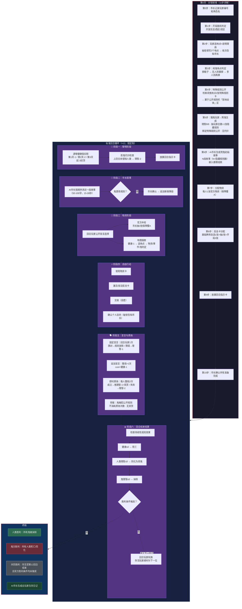

# 《黎明之后》流程图 — 分图1：回合流程

> **版本**：V1.0（2026-07-05）
> **关联图**：总览 / 分图2-9 / 本图为第0天11步+12回合标准流程详解
> **格式**：Mermaid

---

## 分图1：回合流程（第0天 + 12标准回合）

---

## 关键时间线速查

| 回合 | 黎明扣除 | 反击卡存活奖励 | 智慧奖励 |
|:---:|:---:|:---:|:---:|
| 第0天 | — | 开局3张 | — |
| 第1天 | -1 | — | — |
| 第2天 | -2 | — | 宣言抹除2次→+1张 |
| 第3天 | -3 | 存活奖励+1张 | — |
| 第4天 | -3 | — | 宣言抹除4次→+1张 |
| 第5天 | -3 | — | — |
| 第6天 | -3 | 存活奖励+1张 | 宣言抹除6次→+1张 |
| 第7天 | -3 | — | — |
| 第8天 | -3 | — | — |
| 第9天 | -3 | 存活奖励+1张 | — |
| 第10天 | -3 | — | — |
| 第11天 | -3 | — | — |
| 第12天 | -3 | 存活奖励+1张 | 终局检查 |
