# 《黎明之后》流程图 — 分图6：地图系统

> **版本**：V1.0（2026-07-05）
> **关联图**：总览 / 分图1（回合流程） / 分图7（鬼体系）
> **格式**：Mermaid

---

## 分图6：地图系统（A市12地点 + 绑定 + 探索 + 撞鬼）

```mermaid
flowchart TB
    subgraph MAP["A市地图：东西两区12地点"]
        direction TB
        subgraph EAST["东区（编号1-6）"]
            direction LR
            E1["🏥 1.医院"]
            E2["🏫 2.大学"]
            E3["🍺 3.酒吧"]
            E4["📚 4.市图书馆"]
            E5["🏢 5.大厂写字楼"]
            E6["🥬 6.菜市场"]
        end
        subgraph WEST["西区（编号7-12）"]
            direction LR
            W1["🍜 7.大排档"]
            W2["🏸 8.羽毛球馆"]
            W3["🏛️ 9.市博物馆"]
            W4["🛍️ 10.商业步行街"]
            W5["💻 11.网吧"]
            W6["🎤 12.KTV"]
        end
    end

    subgraph DAY0["第0天：玩家选地点"]
        direction TB
        D01["第1步：市长判定开放区域<br/>（东区/西区/双区）"]
        D02["第2步：玩家秘密填写2个地点<br/>告知市长并说明理由"]
        D03["市长检查理由合理性<br/>不合理→要求重选"]
        D04["第3步：掷骰子判定闹鬼地点"]
        D05{"有玩家选中该地点？"}
        D06["重掷"]
        D07{"多人选中？"}
        D08["再掷骰子选撞鬼者<br/>倒霉体质者例外：必中<br/>天生幸运儿例外：掷中作废"]
        D09["第4步：检索地点2张特殊规则<br/>→ 置于公开规则栏「影响全体」"]
        D10["第5步：撞鬼玩家→煞鬼生成"]
        
        D01 --> D02 --> D03 --> D04 --> D05
        D05 --> |"否"| D06
        D06 --> D04
        D05 --> |"是"| D07
        D07 --> |"是"| D08
        D07 --> |"否，就1人"| D09
        D08 --> D09
        D09 --> D10
    end

    subgraph DAY1_SETUP["第1天黎明：地图设置（12地点各三轮判定）"]
        direction TB
        DS1["对每个地点逐次判定"]
        DS2["① 物资设置<br/>随机1-12 → 该地点物资数量"]
        DS3["② 事件设置<br/>扔硬币：人面=是 / 鬼面=否<br/>→ 是否有事件（抽反击卡）"]
        DS4["③ 鬼设置<br/>扔硬币：鬼面=是 / 人面=否<br/>→ 是否有鬼"]
        
        DS1 --> DS2 --> DS3 --> DS4
    end

    subgraph EXPLORE["地图探索流程（物资阶段二选一）"]
        direction TB
        EX1["回合玩家宣言「地图探索」"]
        EX2["给自己放置健康-1指示物"]
        EX3["选择一个地点探索"]
        EX4["按该地点设置依次处理："]
        EX5["a. 物资获取<br/>抽取对应数量物资卡"]
        EX6["b. 事件判定<br/>若有事件 → 抽1张反击卡"]
        EX7["c. 鬼判定"]
        EX8{"是否有鬼？"}
        EX9["回合玩家：理智-1<br/>+ 激活该地点特殊规则<br/>⚠️ 不被同化"]
        EX10["非回合玩家探索<br/>被同化为恶鬼"]
        
        EX1 --> EX2 --> EX3 --> EX4
        EX4 --> EX5 --> EX6 --> EX7 --> EX8
        EX8 --> |"是"| EX9
        EX8 --> |"否"| EX5
        EX8 --> |"非回合玩家"| EX10
    end

    subgraph COIN["硬币机制"]
        C1["人类剪影面 🧑"]
        C2["鬼剪影面 👻"]
        C3["用于：开局区域判定<br/>地图事件判定 · 鬼判定"]
    end

    MAP --> DAY0
    DAY0 --> DAY1_SETUP
    DAY1_SETUP --> EXPLORE
    EXPLORE --> COIN

    style MAP fill:#1a1a2e,stroke:#e94560,color:#eee
    style EAST fill:#16213e,stroke:#0f3460,color:#eee
    style WEST fill:#16213e,stroke:#0f3460,color:#eee
    style DAY0 fill:#16213e,stroke:#0f3460,color:#eee
    style DAY1_SETUP fill:#16213e,stroke:#0f3460,color:#eee
    style EXPLORE fill:#16213e,stroke:#0f3460,color:#eee
    style COIN fill:#1a1a2e,stroke:#533483,color:#eee
    style D10 fill:#6b2c39,stroke:#e94560,color:#eee
    style EX9 fill:#e07a5f,stroke:#e94560,color:#eee
    style EX10 fill:#6b2c39,stroke:#e94560,color:#eee
```

---

## 12地点速查

| # | 地点 | 区域 | # | 地点 | 区域 |
|:---:|------|:---:|:---:|------|:---:|
| 1 | 医院 | 东区 | 7 | 大排档 | 西区 |
| 2 | 大学 | 东区 | 8 | 羽毛球馆 | 西区 |
| 3 | 酒吧 | 东区 | 9 | 市博物馆 | 西区 |
| 4 | 市图书馆 | 东区 | 10 | 商业步行街 | 西区 |
| 5 | 大厂写字楼 | 东区 | 11 | 网吧 | 西区 |
| 6 | 菜市场 | 东区 | 12 | KTV | 西区 |

---

## 撞鬼差异速查

| 场景 | 结果 |
|------|------|
| 第0天撞鬼 | 被同化为煞鬼（理智8/8，抽总数+1规则，无代价） |
| 地图探索（回合玩家） | 理智-1 + 激活特殊规则，不被同化 |
| 地图探索（非回合玩家） | 被同化为恶鬼（理智5/5，抽存活人类数规则，有代价） |
