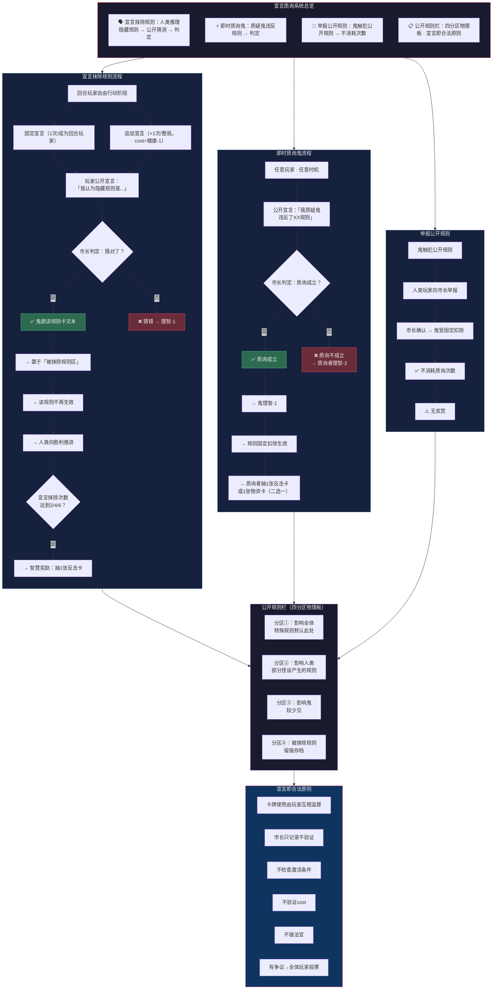

# 《黎明之后》流程图 — 分图4：宣言质询系统

> **版本**：V1.0（2026-07-05）
> **关联图**：总览 / 分图1（回合流程） / 分图5（双维属性） / 分图7（鬼体系）
> **格式**：Mermaid

---

## 分图4：宣言质询系统

---

## 宣言质询速查表

| 操作 | 时机 | 次数 | cost | 成功效果 | 失败惩罚 |
|------|------|:---:|------|------|------|
| 固定宣言 | 回合玩家自由行动阶段 | 1次/成为回合玩家 | 无 | 规则抹除 | 理智-1 |
| 追加宣言 | 本回合已有宣言后 | 整局+1次 | 健康-1 | 规则抹除 | 理智-1 |
| 即时质询 | 任意时机 | 每人整局2次 | 无 | 鬼理智-1+奖赏 | 理智-2 |
| 举报 | 任意时机 | 不限 | 无 | 鬼受固定扣除 | — |
