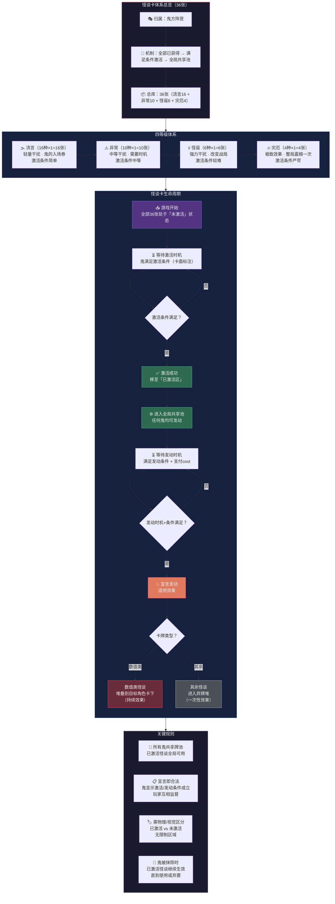

# 《黎明之后》流程图 — 分图2：怪谈卡体系

> **版本**：V1.0（2026-07-05）
> **关联图**：总览 / 分图1（回合流程） / 分图7（鬼体系） / 分图9（卡牌总览）
> **格式**：Mermaid

---

## 分图2：怪谈卡体系（四等级 + 激活/发动流程）

---

## 四等级速查

| 等级 | 数量 | 定位 | 激活条件 |
|------|:---:|------|------|
| 流言 | 16张 | 轻量干扰 | 简单（如"任意回合开始"） |
| 异常 | 10张 | 中等干扰 | 中等（如"有玩家宣言猜错后"） |
| 怪诞 | 6张 | 强力干扰 | 较难（如"有3条以上规则被抹除后"） |
| 灾厄 | 4张 | 极致颠覆 | 严苛（如"场上存在恶鬼时"） |

---

## 与反击卡的关键差异

| 维度 | 怪谈卡（鬼） | 反击卡（人） |
|------|:---:|:---:|
| 初始状态 | 全部已获得（36张均可用） | 逐步获取（开局3张+后续获取） |
| 共享机制 | 全局共享池 | 个人持有 |
| 激活条件 | 鬼满足条件激活 | 人满足条件激活 |
| 发动权 | 任何鬼 | 持有者 |
| 使用后 | 数值类堆叠/其余弃牌 | 按效果去往对应区域 |
