# 《黎明之后》流程图 — 总览：游戏全貌

> **版本**：V1.0（2026-07-05）
> **关联图**：分图1~9，本图为全局导航入口
> **格式**：Mermaid（可在支持Mermaid的Markdown编辑器中直接渲染）

---

## 总览：游戏全貌

```mermaid
flowchart TB
    subgraph PREP["第0天：封锁前夜（11步）"]
        direction TB
        P1["市长记录玩家编号和角色名"] --> P2["开局随机判定（开放区域）"]
        P2 --> P3["玩家选地点+说明理由"]
        P3 --> P4["闹鬼地点判定"]
        P4 --> P5["特殊规则公开"]
        P5 --> P6["撞鬼玩家→煞鬼生成"]
        P6 --> P7["AI市长生成煞鬼故事"]
        P7 --> P8["分配物资（每人1张保障餐A）"]
        P8 --> P9["分配反击卡（自选1+抽2）"]
        P9 --> P10["放置回合指示卡"]
        P10 --> P11["市长确认完成"]
    end

    subgraph LOOP["12回合循环（分图1）"]
        direction TB
        L1["🌅 黎明阶段<br/>递增健康扣除 / 鬼代价"] --> L2["📖 市长叙事<br/>讲述鬼故事段"]
        L2 --> L3["🎒 物资阶段<br/>官方补给 或 地图探索"]
        L3 --> L4["⚡ 自由行动<br/>使用物资/激活卡牌/交易"]
        L4 --> L5["🗣️ 宣言与质询<br/>推理规则 / 质询鬼"]
        L5 --> L6["📊 回合结束结算<br/>生死判定 / 胜利检查"]
    end

    subgraph ENDGAME["终局"]
        E1["人类胜利<br/>所有鬼被抹除"]
        E2["鬼方胜利<br/>所有人类死亡/同化"]
        E3["共同胜利<br/>存活至第12回合结束"]
        E4["全玩家生存日记<br/>AI市长生成"]
    end

    subgraph SYSTEMS["核心机制体系"]
        direction LR
        S1["🃏 卡牌体系<br/>规则52/角色12<br/>反击62/怪谈36<br/>个人目的24/物资81"]
        S2["👻 煞鬼/恶鬼<br/>双轨体系"]
        S3["🗺️ 地图系统<br/>A市12地点"]
        S4["📋 公开规则栏<br/>四分区物理板"]
        S5["🤖 AI市长<br/>6步工作流"]
        S6["❤️ 双维属性<br/>理智+健康"]
    end

    P11 --> LOOP
    LOOP --> |"每回合结束检查"| CHECK{"胜利条件触发？"}
    CHECK --> |"是"| ENDGAME
    CHECK --> |"否，继续"| LOOP

    SYSTEMS -.-> |"支撑"| LOOP
    SYSTEMS -.-> |"驱动"| PREP

    style PREP fill:#1a1a2e,stroke:#e94560,color:#eee
    style LOOP fill:#16213e,stroke:#0f3460,color:#eee
    style ENDGAME fill:#0f3460,stroke:#e94560,color:#eee
    style SYSTEMS fill:#1a1a2e,stroke:#533483,color:#eee
```

---

## 图例

| 符号 | 含义 |
|------|------|
| 实线箭头 | 流程顺序（必须按此执行） |
| 虚线箭头 | 支撑/驱动关系（非流程顺序） |
| 菱形节点 | 判定/分支点 |

---

## 关联图索引

| 分图编号 | 文件名 | 内容 |
|:---:|------|------|
| 总览 | `黎明之后_流程图_总览.md` | 本图 |
| 1 | `黎明之后_流程图_回合流程.md` | 第0天11步 + 12回合各阶段详解 |
| 2 | `黎明之后_流程图_怪谈卡.md` | 怪谈卡四等级体系 + 激活/发动 |
| 3 | `黎明之后_流程图_反击卡.md` | 反击卡四等级体系 + 6条获取 + 激活/发动 |
| 4 | `黎明之后_流程图_宣言质询.md` | 宣言→判定→质询→举报→公开规则栏 |
| 5 | `黎明之后_流程图_双维属性.md` | 理智值 + 健康值 + 生死判定 |
| 6 | `黎明之后_流程图_地图.md` | A市12地点 + 绑定 + 探索 + 撞鬼 |
| 7 | `黎明之后_流程图_鬼体系.md` | 煞鬼/恶鬼生成→理智→规则→代价→继承 |
| 8 | `黎明之后_流程图_AI市长.md` | AI市长6步工作流 + 叙事技法 |
| 9 | `黎明之后_流程图_卡牌总览.md` | 全部卡牌类型关系网络 |
