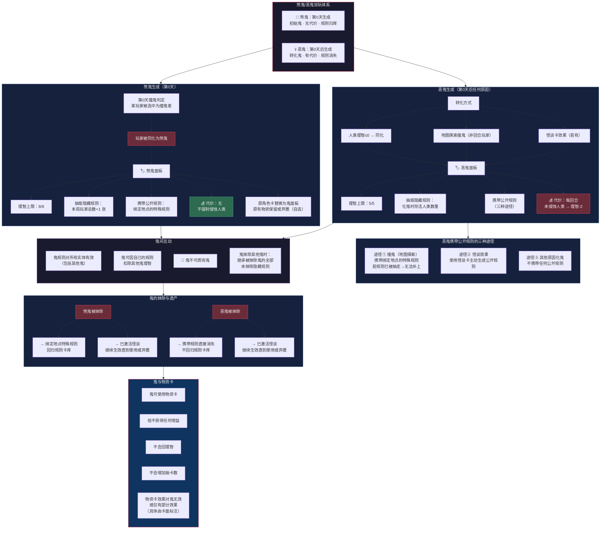

# 《黎明之后》流程图 — 分图7：煞鬼/恶鬼体系

> **版本**：V1.0（2026-07-05）
> **关联图**：总览 / 分图1（回合流程） / 分图4（宣言质询） / 分图5（双维属性） / 分图6（地图）
> **格式**：Mermaid

---

## 分图7：煞鬼/恶鬼体系（生成→理智→规则→代价→继承）

---

## 煞鬼 vs 恶鬼 一键对比

| 维度 | 煞鬼 | 恶鬼 |
|------|------|------|
| 生成 | 第0天撞鬼 | 第0天后任何原因 |
| 理智上限 | 8/8 | 5/5 |
| 隐藏规则数 | 玩家总数+1 | 化鬼时存活人类数 |
| 公开规则 | 绑定地点特殊规则 | 三种途径（或不携带） |
| 代价 | 无 | 每回合未侵蚀→理智-2 |
| 被抹除时规则 | 回归卡库 | 直接消失 |
| 可互扣理智 | 是 | 是 |
| 可质询鬼 | 否 | 否 |
