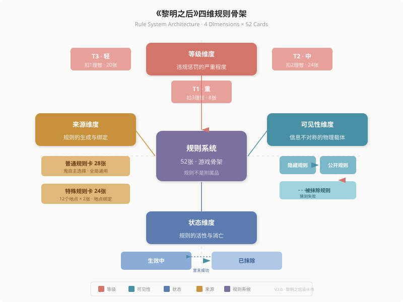

# 《黎明之后》设计书

> **版本**：V1.0（2026-07-06）
> **类型**：精简版游戏设计文稿 —— 面向评选评委 / 求职面试官 / 投资人
> **预计阅读时间**：15-20分钟
> **完整技术文档**：见《黎明之后_设计稿V2.0_完整版.md》

---

## 目录

- [零、封面信息](#零封面信息)
- [一、设计哲学](#一设计哲学)
- [二、四维规则骨架——核心创新](#二四维规则骨架核心创新)
- [三、核心机制精讲](#三核心机制精讲)
  - [3.1 宣言推理：让"不知道规则"成为玩法](#31-宣言推理让不知道规则成为玩法)
  - [3.2 双维属性：两条独立的死亡路径](#32-双维属性两条独立的死亡路径)
  - [3.3 煞鬼/恶鬼双轨体系：鬼阵营的内部博弈](#33-煞鬼恶鬼双轨体系鬼阵营的内部博弈)
  - [3.4 反击卡/怪谈卡：双重事件卡引擎](#34-反击卡怪谈卡双重事件卡引擎)
  - [3.5 地图系统：叙事锚点与气氛组](#35-地图系统叙事锚点与气氛组)
  - [3.6 堆叠式角色面板：物理实体化的叙事语言](#36-堆叠式角色面板物理实体化的叙事语言)
  - [3.7 公开规则栏：信息不对称的物理载体](#37-公开规则栏信息不对称的物理载体)
- [四、卡牌生态体系](#四卡牌生态体系)
- [五、AI市长——桌游主持的范式转移](#五ai市长桌游主持的范式转移)
- [六、角色设计哲学](#六角色设计哲学)
- [七、差异化与市场定位](#七差异化与市场定位)
- [八、设计迭代历程](#八设计迭代历程)
- [九、附录：关键数据](#九附录关键数据)

---

## 零、封面信息

| 项目 | 内容 |
|:---|:---|
| **游戏名** | 《黎明之后》 |
| **副标题** | （规则怪谈-推理反击）社交派对游戏 |
| **游戏类型** | 社交推理 + 规则解谜 + 生存策略 |
| **玩家数量** | 6-12人（推荐8人） |
| **游戏时长** | 90-150分钟 |
| **年龄建议** | 14+ |
| **核心体验** | 解谜 · 生存 · 社交博弈 |
| **主持人** | AI市长（豆包等国产大模型，可视频/语音）或真人 |

### 一句话简介

> 一群幸存者被困在鬼的隐形规则支配的封锁城市中。你不知道什么能做、什么不能说——但每次违规，理智都会崩溃。你必须在12天内推理出鬼的规则、一条条抹除它们，同时保持自己不饿死、不疯掉、不被身边的人背叛。**因为鬼就在你们之中。**

### 三句话卖点

1. **"狼人杀的推理深度 + 密室逃脱的解谜快感 + 生存游戏的资源博弈"**
2. **你不知道规则——你必须推理规则。这条设计原则是游戏一切体验的起点。**
3. **AI市长替代真人主持，零门槛开桌，同时为每局游戏生成独一无二的恐怖叙事。**

---

## 一、设计哲学

### 1.1 核心设计原则

《黎明之后》的建筑逻辑可以浓缩为四个字：**规则为骨**。

整款游戏的一切机制——宣言推理、双维生存、事件卡攻防、角色技能、AI市长叙事——全部生长在"规则系统"这副骨架上。规则不是游戏的附属品，规则本身就是游戏。

从这副骨架出发，三条设计原则贯穿始终：

**原则一：不知道规则 → 推理规则（体验驱动）**

传统桌游的规则是玩家**阅读后遵守**的。本游戏的规则是玩家**观察后推理**的。你不知道边界在哪，但你知道自己越界了——因为理智值在下降。这种"不确定中的确定惩罚"正是灵异怪谈类作品的核心心理机制。我们把它做成了一款桌游。

**原则二：规则约束所有人，包括鬼（公平驱动）**

鬼制定了隐藏规则，但这些规则同样约束鬼自己。鬼也会因为触犯规则被扣理智，甚至被其他鬼利用规则攻击。信息不对称是游戏的核心乐趣，但规则面前人人平等——这是博弈空间的保证。

**原则三：物理实体承载情感（体验驱动）**

我们不满足于纸笔记录数值。堆叠式角色面板让玩家"看到"自己的生存历程；公开规则栏让所有人随时感知规则的压迫；硬币掷出的正反面不只是判定，是命运。每一个物理组件都是为了制造某种情感反馈而设计的。

### 1.2 设计方法

本游戏的设计过程具有鲜明的"直觉驱动"特征：多数核心机制来自灵光乍现，然后通过迭代测试修剪成型。我们保留"感觉好"的机制，即便暂时不确定最终定位；我们删除"感觉对但实际撑不起来"的内容（如早期的鬼每回合讲故事流程）。务实、迭代、情感优先。

---

## 二、四维规则骨架——核心创新

### 2.1 为什么说"规则为骨"？

规则系统有四个维度，如同骨架的四个受力方向。它们共同撑起了整款游戏：

| 维度 | 定义 | 对游戏的影响 |
|:---|:---|:---|
| **一、等级维度** | T1(-3理智) / T2(-2理智) / T3(-1理智) | 决定规则的惩罚强度，影响鬼的策略选择 |
| **二、可见性维度** | 隐藏规则（仅鬼+市长知） / 公开规则（全员可见） / 被抹除规则（留痕存档） | 定义信息不对称的分布，是推理游戏的核心张力 |
| **三、来源维度** | 普通规则卡（28张，通用行为约束） / 特殊规则卡（24张，12地点各2张） | 创造地图与规则的联动，赋予地点以叙事意义 |
| **四、状态维度** | 生效（正在约束行为） / 被抹除（已被人类宣言推理成功） | 驱动游戏进程——每抹除一条规则，人类就更接近胜利 |

### 2.2 骨架图

> ※ 四维规则骨架图。中央紫色节点为规则系统核心，四象限分别展示等级、可见性、状态、来源四个维度。线条代表规则的流动方向，节点代表规则的状态。全图共计52张规则卡，构成游戏一切机制生长的骨架。

### 2.3 这张骨架如何驱动游戏？

**对于人类玩家**：你面前是一张看不见的规则之网。你通过观察（谁被扣理智了？在什么情况下？）、推理（市长故事里的线索）、试探（质询鬼是否违规）来逐步勾勒这张网的形状。每勾勒出一条，你就可以宣言抹除它。

**对于鬼玩家**：你握着这张网的线头。你决定哪些规则在哪些时机最致命，你利用人类的"不知道"来制造混乱，但你也要小心——你的规则同样绑着你。

**对于旁观者（评委/观众）**：这张骨架的妙处在于，它把"推理"这个近乎玄学的桌面体验，变成了一套可物理追踪、可量化判定的系统。规则卡在那里，理智值在那里，宣言对错有明确结果——它不是模糊的"猜谜"，而是一个有清晰反馈回路的推理引擎。

---

## 三、核心机制精讲

### 3.1 宣言推理：让"不知道规则"成为玩法

**这是本游戏最核心的机制。** 也是区别于所有现有桌游的设计。

#### 机制

鬼拥有隐藏规则卡（数量=玩家总数+1），规则内容只有鬼和市长知道。人类玩家通过**宣言**来推理规则：

> *"我宣言：鬼的隐藏规则是——不能说'你、我、他、她'等人称代词！"*

| 判定 | 结果 |
|:---|:---|
| **猜对** | 鬼朗读规则文本 → 规则永久抹除，置于"被抹除规则区" → 人类向胜利迈进 |
| **猜错** | 推理者理智-1 → 更接近疯狂，可能化为新的鬼 |

#### 设计意图

在传统游戏中，"违规"意味着"你读错了规则"；在本游戏中，"违规"意味着"你触犯了某种未知存在的禁忌"。这种不对称信息带来的心理压迫感，是灵异怪谈的核心魅力——你知道有规则，你不知道边界在哪，惩罚是实时的。玩家从"被规则惩罚者"转变为"主动解谜者"。

#### 推理的信息来源

人类推理规则不是盲猜。他们有三条信息来源：

1. **游戏内观察**：看到某人被扣理智 → 回想他刚才做了什么 → 推测触发行为
2. **市长叙事**：每回合市长讲述的诡异故事中嵌入了规则的隐晦线索（见第五章）
3. **质询验证**：对鬼发起质询，验证自己的推理假设

#### 宣言次数设计

- 固定宣言：每位玩家每次轮到自己的回合时获得1次
- 追加宣言：整局游戏额外+1次机会，cost=健康值-1
- 智慧奖励：成功抹除规则达2/4/6次时各抽1张反击卡

这个次数设计保证了推理不是无限尝试——每次宣言都是一场赌博。

---

### 3.2 双维属性：两条独立的死亡路径

#### 设计逻辑

| 属性 | 初始值 | 归零后果 | 主要扣除来源 | 恢复途径 |
|:---|:---|:---|:---|:---|
| **健康值** | 6/6 | 直接死亡，退出游戏 | 每天黎明递增扣除（-1/-2/-3封顶） | 面包/水/药品/罐头等物资卡 |
| **理智值** | 6/6 | 被同化为恶鬼（转变阵营） | 触犯规则、宣言猜错、质询失败、怪谈卡攻击 | 水、特定反击卡、角色技能 |

#### 设计意图

两条死亡路径对应两种不同的失败方式——饿死（健康归零）是生存失败，疯掉（理智归零）是精神失败。而疯掉更可怕：你会变成新的鬼，反过来加入猎杀者的行列。这个设计制造了一个精妙的社交困境：

> 你的朋友理智值很低，他可能下一回合就变成鬼。你该帮他吗？帮他，他可能反过来害你。不帮他，人类阵营少一个人。**这就是"生存困境"的桌游化表达。**

两条路径**严格分离**——理智值只与规则/灵异挂钩，健康值只与生存/物资挂钩。这是刻意为之：它避免了"一卡万能"的数值通胀，迫使玩家在两种压力之间做策略权衡。

#### 递增黎明扣除

健康值的扣除不是线性的。第1天-1，第2天-2，第3天起-3封顶。这个递增曲线制造了一个精妙的时间压力：

> 前3天是"新手村"——你还有余裕推理和试探。从第4天起，生存压力陡增，你必须在"活下去"和"推理规则"之间做出艰难选择。

---

### 3.3 煞鬼/恶鬼双轨体系：鬼阵营的内部博弈

#### 为什么鬼需要两种？

在大多数"卧底类"桌游中，卧底的目标是隐藏自己。但《黎明之后》的鬼不是一个简单的"卧底"——它是一个阵营，而这个阵营内部并不团结。

| 属性 | 煞鬼（初始鬼） | 恶鬼（转化鬼） |
|:---|:---|:---|
| 理智上限 | 8/8 | 5/5 |
| 隐藏规则数 | 玩家总数+1 | 存活人类数 |
| 代价 | 无 | 每回合未侵蚀人类 → -2理智 |
| 死亡时规则去向 | 回归规则卡库 | 直接消失 |

#### 设计意图

煞鬼是"原初之鬼"——强大、稳定、规则多。恶鬼是"新转化者"——脆弱、被迫攻击、规则少。

这个不对称设计创造了鬼阵营内部的张力：

- 煞鬼希望保护恶鬼（人类多一个敌人）
- 但恶鬼的规则少、容易死，死了规则还消失
- 煞鬼可以攻击恶鬼——鬼互扣理智是合法的
- 被抹除的鬼的规则可以被其他鬼继承

**鬼并不团结。** 这正是我们希望制造的"阵营内博弈"——你永远不知道身边的"同伴"是真的同伴，还是在等待机会吞噬你的规则。

---

### 3.4 反击卡/怪谈卡：双重事件卡引擎

#### 体系对比

| 维度 | 反击卡（人类） | 怪谈卡（鬼） |
|:---|:---|:---|
| 总数 | 62张 | 36张 |
| 等级 | 基础36 + 觉醒16 + 极致8 + 真理2 | 流言16 + 异常10 + 怪诞6 + 灾厄4 |
| 获得方式 | 初始3张 + 6条获取机制 | 开局36张全部已获得 |
| 激活条件 | 满足条件后激活 | 满足条件后激活 |
| 使用方式 | 人类各自持有，各自激活 | 鬼共享牌池，任意鬼发动 |

#### 设计意图

反击卡是"推理成功后的人类反击手段"。你可以宣言抹除鬼的规则（防御），你也可以发动反击卡攻击鬼（进攻）。这种"推理+反击"的复合体验，赋予了人类阵营主动性——你不是在被动等待鬼犯错，而是在主动破局。

怪谈卡是"鬼的叙事武器"。重要的设计点在于**共享池机制**：所有怪谈卡属于所有鬼。这既消除了"单个鬼卡牌太多"的操作负担，又创造了鬼之间的协作可能——煞鬼激活条件A，恶鬼发动怪谈A。

---

### 3.5 地图系统：叙事锚点与气氛组

A市12个地点的地图只在第0天使用——但它决定了接下来的整局游戏。

**第0天流程**：每位玩家秘密填写两个"昨天去过"的地点 → 市长掷骰子确定闹鬼地点 → 该地点的某位玩家被执念侵蚀，化为煞鬼 → 该地点的2张特殊规则卡即刻公开。

#### 设计意图

地图是"轻量气氛组"，但承载了重要的叙事功能：

- 不是随机分配身份——"你昨天去了医院，医院闹鬼了，所以鬼附在了你身上"——这个因果链让化鬼有了叙事合理性
- 特殊规则卡的"地点绑定"赋予地点以个性——医院的规则和酒吧的规则是不同的，地图从"背景板"变成了"机制变量"
- 硬币的正反面（人类/鬼剪影）投掷判定增加了仪式感

地图对游戏内机制的影响有限——但我们保留了它。因为"灵光一现的设计，觉得非常好"。

---

### 3.6 堆叠式角色面板：物理实体化的叙事语言

#### 设计

角色卡不是一张平面的纸。它是一个六区域的面板系统，所有物资卡使用后**插入角色卡下方**，形成物理堆叠。游戏结束时，你的角色卡下方堆着一叠厚厚的卡——那是你12天的生存痕迹。

#### 设计意图（用户原话）

> "物资打出即弃，符合卡牌直觉，但无法体验角色的经历和成长弧光。而堆叠到角色卡底下，不论物资是否使用成功、事件卡结算情况，都会一目了然，明确感觉到人物经历了什么。"

- **角色历程可视化**：面板从空到厚，直观记录生存轨迹
- **白热化标志**：堆叠越厚，游戏越接近尾声——类似三国杀中装备区填满的"全装"感觉
- **情感共鸣**：玩家看到面板上的厚度，产生"我经历了这么多"的代入感

纸笔记录看不到"厚度"，APP数字界面无法提供"插入动作"带来的仪式感。物理卡牌的堆叠本身就是一种叙事语言。

---

### 3.7 公开规则栏：信息不对称的物理载体

一块四分区物理板：

| 分区 | 内容 | 可见性 |
|:---|:---|:---|
| 影响全体的公开规则 | 特殊规则卡、部分怪谈产生的规则 | 全员可见 |
| 只影响人的公开规则 | 部分怪谈产生 | 全员可见 |
| 只影响鬼的公开规则 | 较少见 | 全员可见 |
| 被抹除规则 | 已被宣言推理成功的规则 | 留痕存档 |

#### 设计意图

公开规则栏是"信息不对称"的物理化。当鬼将一张新的公开规则卡放入"影响全体"分区时，全场的气氛都会变化——一条新的规则被加到了所有人的枷锁上。而当人类抹除一条规则，将它移入"被抹除规则"分区时，那是全场欢呼的时刻。物理板的四个分区让规则的状态流转可视化——规则在哪，所有人都能看到。

---

## 四、卡牌生态体系

### 4.1 总览

| 卡牌类别 | 数量 | 归属 | 核心机制 |
|:---|:---|:---|:---|
| 规则卡 | 52张 | 鬼持有 | 普通28 + 特殊24（12地点×2）；T1=8/T2=24/T3=22 |
| 角色卡 | 12张 | 人/鬼 | 5类型满额；六区域面板设计 |
| 反击卡 | 62张 | 人类使用 | 四等级：基础36 + 觉醒16 + 极致8 + 真理2 |
| 怪谈卡 | 36张 | 鬼使用 | 四等级：流言16 + 异常10 + 怪诞6 + 灾厄4 |
| 个人目的卡 | 24张 | 人类持有 | 秘密目标，无奖惩，纯粹成就驱动 |
| 物资卡 | 81张 | 人/鬼使用 | 五等级：官方18 + 普通34 + 中级18 + 高级8 + 绝顶3 |
| **合计物理卡牌** | **~270张** | | |

### 4.2 反击卡的6条获取机制

| 机制 | 触发条件 |
|:---|:---|
| A. 初始 | 第0天基础选取1张 + 牌库洗切后抽2轮 = 开局3张 |
| B. 效果 | 人物技能或事件卡效果获取 |
| C. 不屈 | 人类死亡/化鬼时，剩余全员各抽1张 |
| D. 智慧 | 成功抹除规则达2/4/6次时各抽1张 |
| E. 奖赏 | 质询鬼成功，抽1张 |
| F. 存活 | 存活到3/6/9/12回合时，该回合黎明抽1张 |

6条获取机制覆盖了游戏的各个方面——初始分配、技能获取、逆境触发、智慧奖励、主动质询和持久存活。这是刻意设计的"全覆盖式"卡牌经济系统，确保玩家在任何情境下都有获取新反击卡的可能。

### 4.3 怪谈卡的共享池机制

所有36张怪谈卡开局全部属于鬼阵营，处于**未激活**状态。任何鬼满足激活条件即可激活，激活后的怪谈进入全局共享池，任何鬼都可发动。

这个设计的妙处在于：它消除了传统TCG中"我抽不到关键卡"的运气因素——所有卡都在那里，问题只是你能不能激活它们。

---

## 五、AI市长——桌游主持的范式转移

### 5.1 为什么选择AI？

传统桌游的真人主持面临三个不可回避的痛点：

| 痛点 | 问题 | AI如何解决 |
|:---|:---|:---|
| **记忆负担** | 规则、理智值、健康值、事件卡发放时机……真人很难零失误 | 精确记录每个状态，永不遗忘 |
| **主观偏袒** | 熟人局中市长难免潜意识倾向 | 可预设的"隐藏目的"随机池，不受人情影响 |
| **氛围营造不稳定** | 好的主持需要天赋，大部分人做不到 | 稳定输出符合末世怪谈氛围的判定话术 |

更重要的是，AI市长降低了桌游的组织门槛——玩家只需一台手机（豆包免费、可视频、可语音），无需专门找主持人。

### 5.2 AI市长的核心职能

| 职能 | 说明 |
|:---|:---|
| **记录者** | 精确追踪每个玩家的状态、每条规则的状态、每张卡的发放 |
| **叙事者** | 基于煞鬼的隐藏规则和初始地点，为每条规则生成一段含隐晦推理线索的故事 |
| **判定者** | 宣言猜对/猜错、质询成立/不成立——一句话判定，不辩论 |
| **结算者** | 黎明扣除、死亡判定、同化判定、胜利条件检测 |
| **终局叙事** | 为每位玩家生成"生存日记"——叙事与复盘合一 |

### 5.3 AI叙事引擎：海龟汤式的故事生成

这是AI市长最具创新性的功能。AI市长不讲述"有人违规→受到惩罚"的因果链，而是讲述"被规则扭曲过的日常记忆碎片"。

**核心原则**：规则是"箭"，故事是"靶子"。靶子要包住箭，但不在靶子上标出箭的位置。

**示例**：

| 规则 | 不给提示的故事 | 给出的故事 |
|:---|:---|:---|
| "不能有认可的表达" | ❌ "有人说谢谢然后嘴合不上了" | ✅ "我小时候，妈妈总是喜欢别人家的孩子，而不喜欢我。" |

关键：故事让玩家知道"这条规则长什么样"（日常语言中"喜欢"≈"认可"），但不告诉"这条规则在哪里"（需要结合游戏中观察到有人点头赞同被扣理智才能锁定）。

这种"海龟汤难度"的叙事设计，让市长故事从"背景音"升级为"推理线索源"。

---

## 六、角色设计哲学

### 6.1 五类型覆盖

| 类型 | 角色数 | 角色 | 设计理念 |
|:---|:---|:---|:---|
| **命运操控者** | 3 | 天生幸运儿、倒霉体质者、觉醒者 | 影响随机判定结果，改变命运走向 |
| **攻击者** | 3 | 逻辑严谨理科生、街道社区主任、整顿末世零零后 | 擅长宣言推理和攻击鬼方 |
| **自保型** | 2 | 沉寂的上班族、乐天派幸存者 | 生存能力突出，低风险稳发育 |
| **情报型** | 2 | 灵异研究者、法医侦探 | 收集情报，辅助推理 |
| **资源型** | 2 | 豪门之后、外卖单王 | 物资获取能力突出，支援队友 |

### 6.2 设计原则

**不对称但平衡**：5种类型覆盖了不同的游戏风格，每个角色有独特的技能面板。角色之间不追求数值平等，而是追求"在不同游戏阶段发力的差异化节奏"。例如"沉寂的上班族"前期最弱（4/4双维），但完美觉醒后成为全场最强（10/10）。

**技能叙事化**：每个角色的技能不是纯粹的数据修正——它们有叙事合理性。"倒霉体质者"的厄运吸附反映了"事总会找上他"的人设；"豪门之后"的"全场消费由我请客"和"有钱能使鬼推磨"让"钱能通神"的主题贯穿始终。

---

## 七、差异化与市场定位

### 7.1 与现有桌游的差异化

| 对比维度 | 狼人杀/阿瓦隆 | 密室逃脱/剧本杀 | 《黎明之后》 |
|:---|:---|:---|:---|
| **核心玩法** | 身份推理/投票淘汰 | 解谜/剧情推进 | **规则推理 + 生存策略 + 事件卡博弈** |
| **信息不对称** | 狼人知道同伴 | 所有人知道同样信息 | **鬼知道规则，人类不知道——但人类可以通过观察推理** |
| **失败方式** | 投票出局 | 解不出谜/时间到 | **两条独立的死亡路径：饿死或疯掉** |
| **主持人依赖** | 需要真人法官 | 需要DM引导 | **AI市长可替代真人，零门槛** |
| **重玩性** | 中等（角色固定） | 低（剧本一次性） | **高：随机规则+随机角色+随机事件卡=每局不同** |
| **情感体验** | 紧张/猜疑 | 沉浸/解谜 | **压迫感 + 智力的胜利感 + 生存的绝望感 + 终局的叙事回味** |

### 7.2 目标受众

- **核心受众**：18-35岁桌游爱好者，喜欢社交推理和策略博弈
- **扩展受众**：密室逃脱/剧本杀玩家（寻求更强调机制的解谜体验）、团建组织者（AI市长降低门槛）
- **商业场景**：桌游吧常驻游戏、公司团建、校园社团活动

### 7.3 竞争优势

1. **机制创新**："不知道规则→推理规则"是桌游设计中的空白区域
2. **技术加持**：AI市长是桌游行业的技术前瞻性设计
3. **高重玩性**：随机规则+随机角色+事件卡驱动，每局体验不同
4. **情感厚度**：堆叠面板+终局日记，给玩家"打完不是白打"的故事感

---

## 八、设计迭代历程

| 版本 | 日期 | 核心变更 |
|:---|:---|:---|
| V1.4 | 2026-06-20 | 初版双层架构：公开剧本+隐藏规则，三重引擎，双维属性 |
| V1.5 | 2026-06-21 | 六区域面板，规则卡数学模型升级至128张总库，抢救窗口机制 |
| V1.6 | 2026-06-22 | 递增黎明扣除，角色差异化，模块化更新模式确立 |
| V1.7 | 2026-06-24 | 地图系统，公开规则栏，自愿交易，双引擎，基础回合指示卡 |
| V1.8 | 2026-06-28 | 角色扩至12人（五类型满额），反击卡体系扩展 |
| V1.9 | 2026-07-02 | 规则/怪谈/个人目的卡全部竣工，宣言质询体系重构 |
| V2.0 | 2026-07-05 | 12回合固定制，煞鬼/恶鬼双轨，AI市长叙事接管，5个图鉴全部竣工 |

**当前状态**：全部5个图鉴竣工（规则卡52/角色12/反击卡62/怪谈卡36/个人目的卡24），11个机制子稿活跃维护中，网站第一期已部署，AI市长叙事引擎通过三轮测试验证。

---

## 九、附录：关键数据

### 9.1 卡牌总数

| 类别 | 种类 | 物理张数 |
|:---|:---|:---|
| 规则卡 | 52种 | 52张 |
| 角色卡 | 12种 | 12张 |
| 反击卡 | 62种 | 62张 |
| 怪谈卡 | 36种 | 36张 |
| 个人目的卡 | 24种 | 24张 |
| 物资卡 | 5等级 | 81张 |
| **合计** | | **~270张** |

### 9.2 游戏参数

| 参数 | 数值 |
|:---|:---|
| 玩家数 | 6-12人（推荐8人） |
| 游戏时长 | 90-150分钟 |
| 回合数 | 0+12固定 |
| 初始鬼数 | 1（煞鬼） |
| 初始隐藏规则数 | 玩家总数+1 |
| 存活奖励回合 | 第3/6/9/12回合 |
| 公开规则栏分区 | 4个 |

### 9.3 文件体系

- 5个图鉴（卡片权威来源）
- 11个机制子稿（机制权威来源）
- 总设计稿V1.9/V2.0（版本快照）
- AI市长指令（运行时提示词，~4000字）
- 卡牌数据库JSON（结构化数据，156种/188张物理卡）
- 10张流程图（Mermaid格式）
- 网站第一期（已部署至CloudStudio）

---

> **《黎明之后》设计书 V1.0**
> 2026年7月6日
> 设计师：小马
>
> 完整技术文档：见《黎明之后_设计稿V2.0_完整版.md》
> 网站预览：CloudStudio已部署
> 联系：xiaomaonlineDQ
